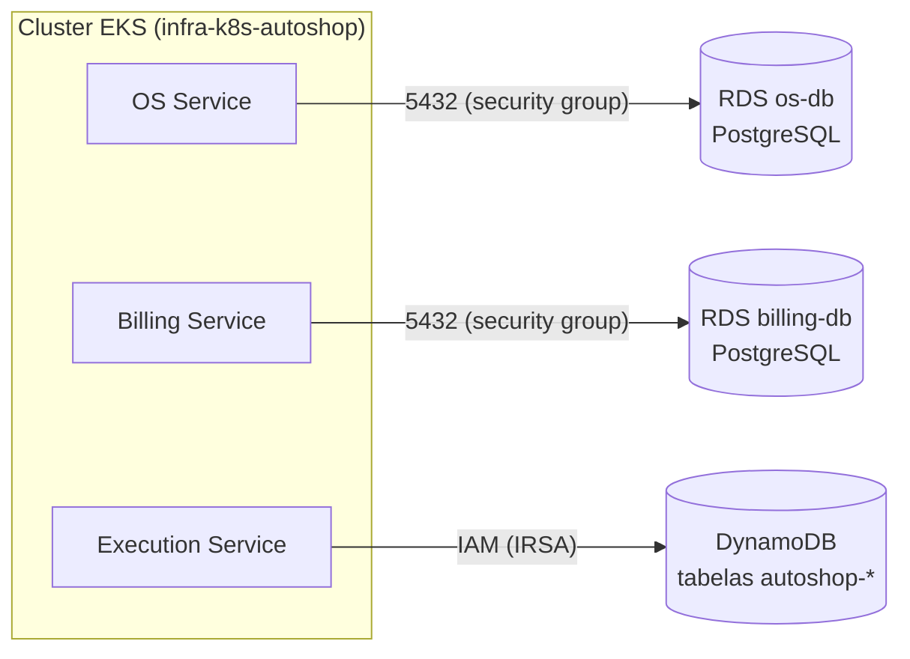

# infra-db-autoshop

Bancos de dados dos microsserviços do AutoShop, em Terraform. Cada serviço
tem o próprio banco e nenhum serviço acessa o banco de outro
([ADR-008](https://github.com/Jackeline2020/app-autoshop/blob/main/docs/adr/ADR-008-banco-por-servico.md)).

| Stack | Serviço | Banco | Recursos |
|---|---|---|---|
| [`os/`](os) | OS Service ([`app-autoshop`](https://github.com/Jackeline2020/app-autoshop)) | PostgreSQL 16 | Instância RDS `os-db`, security group, segredo `autoshop/os/db` |
| [`billing/`](billing) | Billing Service ([`billing-autoshop`](https://github.com/Jackeline2020/billing-autoshop)) | PostgreSQL 16 | Instância RDS `billing-db`, security group, segredo `autoshop/billing/db` |
| [`execution/`](execution) | Execution Service ([`execution-autoshop`](https://github.com/Jackeline2020/execution-autoshop)) | DynamoDB | Tabelas `autoshop-parts`, `autoshop-reservations`, `autoshop-executions`, `autoshop-processed_messages` (com expiração) |

Cada stack tem estado e `apply` próprios: criar, alterar ou destruir um
banco não afeta os outros. As duas instâncias PostgreSQL usam o mesmo
módulo ([`modules/postgres`](modules/postgres)), com usuário e senha
próprios.



- **Acesso:** as instâncias RDS não são públicas e só aceitam conexões dos
  nodes do EKS. O acesso ao DynamoDB é liberado apenas para a role do pod
  do Execution (IRSA, definida no `infra-k8s-autoshop`).
- **Esquema:** OS e Billing aplicam as próprias migrations no deploy (Job
  do Kubernetes); as tabelas do DynamoDB são criadas por esta stack.

## Como aplicar

Pré-requisitos: Terraform >= 1.5, credenciais da AWS e o cluster já
criado pelo `infra-k8s-autoshop` (o security group dos nodes é usado nas
regras de acesso dos bancos).

```bash
SG=$(terraform -chdir=../infra-k8s-autoshop/infra/aws output -raw eks_node_security_group_id)

terraform -chdir=os init
terraform -chdir=os apply -var="eks_node_security_group_id=$SG"

terraform -chdir=billing init
terraform -chdir=billing apply -var="eks_node_security_group_id=$SG"

terraform -chdir=execution init
terraform -chdir=execution apply
```

Saídas usadas nos secrets dos repositórios dos serviços:

| Stack | Saída | Secret |
|---|---|---|
| `os` | `db_host`, `db_password` | `DB_HOST`, `DB_PASSWORD` do `app-autoshop` |
| `billing` | `db_host`, `db_password` | `DB_HOST`, `DB_PASSWORD` do `billing-autoshop` |

A senha é lida com `terraform output -raw db_password`.

Para remover: `terraform destroy` em cada stack.

## Pipeline

`.github/workflows/ci-cd.yml` valida as três stacks em paralelo
(`terraform fmt`, `init` e `validate`) em todo pull request e push para
`develop` e `main`.
